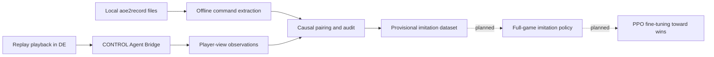

# AoE II RL Lab

**Building a reinforcement-learning agent for Age of Empires II: Definitive Edition, one measurable step at a time.**

The goal is a bot that can play a complete match and learn to win. The work starts with the less glamorous parts that make learning possible: reliable game control, observations that respect fog of war, replay-derived demonstrations, and evidence that an action actually happened.

This repository contains the Python package, CONTROL integration, replay tools, an experimental opening learner, and the research notes behind the approach. **It does not yet contain a trained full-game agent or a demonstrated win rate against Extreme AI.**

[Quick start](#quick-start) · [Replay workflow](#replay-workflow) · [Learning approach](#learning-approach) · [Roadmap](#roadmap) · [Documentation](#documentation)

## What works today

| Component | Current status |
| --- | --- |
| Native game connection | Movement and house construction demonstrated through AoE2Control's Agent Bridge |
| Scripted opening | Two villagers build one house; the third builds another; two livestock go to the TC while the scout and remaining livestock explore |
| Replay command extraction | 10 local recordings converted into 19,629 selected-player commands and 8,196 command-history examples |
| State/action capture | One three-game-minute pilot: 781 observations, 32 provisional pairs |
| Offline sample audit | Structural checks passed; 21 pairs had matching effects before the next player command; 11 remained unconfirmed |
| Opening RL | Recurrent PPO and scripted-teacher imitation implemented; training and automatic restart integration remain unverified |
| Full-game learning | Planned: broader actions, human-replay imitation, reliable outcomes, and win-driven fine-tuning |

Status reflects the local project as of **5 November 2026**. Recordings, captures, generated reports and checkpoints are not included in the repository. These are integration milestones, not evidence of competitive playing strength.

## Why this project

A useful RTS agent must coordinate an economy, production, scouting, research and combat over a long match. Rewarding every building or resource deposit can encourage activity without encouraging victory. Training from scratch also spends substantial simulation time discovering basic mechanics.

The proposed direction is to initialize a policy from demonstrations, then improve it with reinforcement learning against measurable match outcomes. The immediate objective is to establish trustworthy inputs, actions and evaluation before scaling the learner. The [literature review](docs/RTS_WINNING_LITERATURE.md) compares relevant RTS work and discusses reward design, algorithm choices and compute limits.

## How the pieces fit together



The existing opening learner and synthetic combat experiments are separate, narrower learning tasks. They do not consume the human-replay dataset as a full-game policy today.

## Requirements

- **Python 3.12** and Git.
- **Windows** for live DE integration and named-pipe communication.
- A local installation of **Age of Empires II: Definitive Edition** for capture or control.
- A compatible **[AoE2Control release](https://github.com/aoe2control/AoE2Control/releases)**, installed separately.
- A GPU is optional for the examples below; CPU is the default learning device. The pinned main environment includes a CUDA-enabled PyTorch build and is a substantial download.

The last demonstrated live combination was **CONTROL 1.1.5 + DE executable 101.103.57257.0**. This is a compatibility reference, not a promise that an arbitrary newer game build works. Check CONTROL's diagnostics after game updates.

Game files and CONTROL binaries are not bundled. Offline extraction uses a separate environment with `mgz==1.8.51` and a scoped header adapter; support for other replay formats has not been established.

## Quick start

Clone or download this repository and open **PowerShell in its root**, beside `pyproject.toml`. Commands below use PowerShell syntax.

### 1. Install the environments

```powershell
.\scripts\setup_environment.ps1 -Environment both
```

This creates:

| Environment | Purpose |
| --- | --- |
| `.venv` | Game bridge, observation capture, auditing and learning tools |
| `.venv-replays` | Isolated replay parser and offline command extraction |

Use `-Environment main` or `-Environment replays` to install only one. Setup registers the `src/aoe2rl` package in editable mode and applies the replay header adapter when installing the parser environment. It does not launch DE, capture data or train a model.

For a manual main-environment setup:

```powershell
py -3.12 -m venv .venv
.\.venv\Scripts\python.exe -m pip install -r requirements-lock.txt --extra-index-url https://download.pytorch.org/whl/cu128
.\.venv\Scripts\python.exe -m pip install --no-deps -e .
```

### 2. Explore the commands without opening the game

```powershell
.\.venv\Scripts\python.exe -m aoe2rl.cli --help
.\.venv\Scripts\python.exe -m aoe2rl.replay_examples --help
.\.venv\Scripts\python.exe -m aoe2rl.train_opening --help
```

The package is named `aoe2rl`; the repository folder can have any name. After installation, module commands work through the environment's Python. Run operational commands from the repository root so relative config and output paths are consistent.

### 3. Try the synthetic software example

This requires no game connection:

```powershell
.\.venv\Scripts\python.exe -m aoe2rl.cli benchmark --backend synthetic --episodes 20 --output reports/synthetic-example.json
```

To exercise the existing learning/checkpoint code:

```powershell
.\.venv\Scripts\python.exe -m aoe2rl.cli train --backend synthetic --algorithm bc-ppo --seconds 60 --max-episodes 20 --output runs/synthetic-example
```

The synthetic backend is a small software fixture, not an AoE simulator. Its imitation phase uses a scripted teacher. Results from it say nothing about a bot's ability to win a DE match.

## Replay workflow

An `.aoe2record` supplies commands and starting information; it is not already a sequence of player-view observations. Replay playback through the game supplies those observations. Extraction, capture and pairing are separate steps.

### 1. Import recordings and extract commands

For recordings stored in the usual Windows game folder:

```powershell
$recordings = Join-Path $env:USERPROFILE "Games\Age of Empires 2 DE"
.\.venv\Scripts\python.exe scripts/import_recordings.py --source $recordings --build 101.103.57257.0 --player 1 --output data/replays
.\.venv-replays\Scripts\python.exe -m aoe2rl.replay_data --output data/replays/extracted-v1
```

The build above is the previously demonstrated version. The importer filters filenames; it does not certify playback compatibility. Original files remain unchanged. Copies are named by SHA-256, and derived outputs retain provenance. Change `--player` to the player slot you intend to imitate. Use a fresh extraction output directory on subsequent conversions.

### 2. Choose a recording

List the parsed recordings, then select an entry with examples:

```powershell
$dataset = Get-Content data/replays/extracted-v1/summary.json -Raw | ConvertFrom-Json
$dataset.parsed | Format-Table original_filename, selected_player, civilization, map_name, history_examples
$replay = $dataset.parsed | Where-Object { $_.history_examples -gt 0 } | Select-Object -First 1
$meta = "data/replays/extracted-v1/$($replay.replay_sha256)/metadata.json"
$replay | Format-List original_filename, selected_player, selected_player_name, civilization, map_name
```

Load that **exact recording** in DE, select the matching player's view and normal fog, and pause within its first five game seconds. Attach CONTROL, enable **Modules → Agent Bridge** and the selected player's **Agent Bridge**, and leave **See Everything off**. Run the Python client under the same Windows account as DE. See [bridge setup](docs/AGENT_BRIDGE_SETUP.md).

### 3. Capture a short pilot

```powershell
.\.venv\Scripts\python.exe -m aoe2rl.replay_examples capture --metadata $meta --confirm-replay --seconds 300 --interval 0.05 --output data/replays/captures/pilot-01
```

Unpause when prompted. The recorder checks the starting units and TC, reads observations, reports progress and records separate visibility snapshots. It sends no gameplay commands. When capture finishes, **replay playback keeps running**; pause or close DE yourself.

Start at normal speed. Faster playback can leave observations too far apart to pair reliably. `--full-replay` is available, but its end-handling and the newer visibility-capture options still need live validation. Pairing and auditing currently load observations into memory, so establish data size with a short pilot before collecting whole matches.

### 4. Pair and audit the capture

After capture reports `complete`:

```powershell
.\.venv\Scripts\python.exe -m aoe2rl.replay_examples join --capture data/replays/captures/pilot-01 --output data/replays/paired/pilot-01
.\.venv\Scripts\python.exe -m aoe2rl.replay_audit --capture data/replays/captures/pilot-01 --paired data/replays/paired/pilot-01 --output reports/pilot-01-audit
```

Read the pairing `summary.json` and the audit's `review.md` and `example-review.json`. Each output directory must be new; existing captures are preserved.

### What the dataset does and does not establish

- An observation must strictly precede its command and be no more than 250 game milliseconds old.
- Missing unit selections remain unresolved rather than being guessed from another player's actions.
- Same-tick commands are retained separately as groups, with explicit masks for unsupported labels.
- A recorded input is a **command attempt**. Repeated clicks with insufficient resources can have no effect.
- Post-command effects are audit evidence, never policy inputs.
- Queue modifiers, complete action semantics and authoritative outcome labels remain incomplete.
- Train/validation assignment keeps each replay together, including detected repeated perspectives of a game.
- Player-view checks and a visually correct opening do not certify every fog transition or hidden-information boundary.

The [imitation guide](docs/IMITATION_DATA.md) has the implementation details and troubleshooting notes.

## Live opening control and learning

The scripted opening is the simplest demonstrated live behavior. Follow [its setup guide](docs/TWO_HOUSE_OPENING.md) before running:

```powershell
.\.venv\Scripts\python.exe -m aoe2rl.opening --execute --seconds 180
```

This **issues commands in the game**. Use the guide's fresh, disposable single-player match configuration. It builds two additional houses and manages local scouting/livestock; it is not a complete build order.

An experimental recurrent PPO learner for the same opening is available in `aoe2rl.train_opening`. Its restart helper and training integration have not been demonstrated end to end. Follow [opening RL setup](docs/OPENING_RL.md), which explains the constrained actions, rewards and first short run. Neither the opening learner nor the older combat environment is a full-game winning agent.

## Learning approach

The proposed full-game baseline is **behavioral cloning followed by recurrent PPO**, using legal-action handling and a policy that remembers earlier observations. Demonstrations should reduce blind exploration; match outcomes should remain the main objective.

Resource collection, idle production, losses and scouting are useful observations and diagnostics. They are not automatically good standalone rewards: a policy can maximize production or harvesting while failing to attack or win. The research plan compares outcome-only learning with carefully bounded shaping and evaluates checkpoints by held-out match results.

This is a research direction, not an implemented full-game training recipe. See the [RTS literature review](docs/RTS_WINNING_LITERATURE.md) for AlphaStar, OpenAI Five, other RTS systems and the tradeoffs relevant to a single-machine project.

## Roadmap

- [x] Establish native game observation and command transport.
- [x] Demonstrate the scripted two-house/scouting opening.
- [x] Extract replay commands and capture a first state/action pilot.
- [x] Add causal pairing, provenance checks and per-command effect review.
- [ ] Validate enemy visibility transitions and the richer recorder.
- [ ] Decode repeated selections and broaden supported action semantics.
- [ ] Build a larger, varied dataset with held-out matches.
- [ ] Implement a full-game imitation policy and action executor.
- [ ] Validate resets, outcomes and simulation throughput for RL.
- [ ] Fine-tune toward wins and benchmark against fixed opponents, including Extreme AI.

Compute feasibility remains open. A local GPU can train small networks; obtaining enough reliable, independent game experience may be the limiting factor. See the [feasibility assessment](docs/FEASIBILITY.md).

## Repository layout

```text
src/aoe2rl/              Python package: bridge, replay tools, environments, learners
scripts/                 Environment setup, intake and operational tools
tests/                   Existing automated tests
bridge/                  CONTROL Lua modules and opponent scripts
config/                  Experiment configs and example local configuration
docs/                    Guides, research and historical investigations
data/                    Local datasets; replay contents ignored by Git
reports/                 Generated diagnostics and audits; ignored
runs/                    Checkpoints and training logs; ignored
vendor/                  Separately downloaded third-party tools; ignored
pyproject.toml           Package metadata and source-layout configuration
requirements-lock.txt    Main environment dependency pins
requirements-replays.txt Isolated parser dependency pins
```

See [project layout](docs/PROJECT_LAYOUT.md) for environment repair and historical path resolution after moving a checkout. A clone contains neither the local dataset nor the proprietary game/bridge binaries.

## Development and contributions

Issues and focused pull requests are welcome, especially around replay decoding, observation quality, command semantics and reproducible evaluation. Start with [CONTRIBUTING.md](CONTRIBUTING.md).

To run the existing tests manually:

```powershell
.\.venv\Scripts\python.exe -m pytest -q
```

The suite does not cover every newer replay or training component. Passing software tests does not establish live fog correctness, reliable resets or playing strength. No current CI badge or full-game benchmark is claimed.

## Documentation

- [Documentation index](docs/README.md)
- [Native Agent Bridge setup](docs/AGENT_BRIDGE_SETUP.md)
- [Replay intake](docs/REPLAY_DATASET.md) and [imitation data workflow](docs/IMITATION_DATA.md)
- [Scripted opening](docs/TWO_HOUSE_OPENING.md) and [opening learner](docs/OPENING_RL.md)
- [Research review](docs/RTS_WINNING_LITERATURE.md), [feasibility](docs/FEASIBILITY.md) and [implementation status](docs/STATUS.md)

Some historical notes refer to local reports that are deliberately not published. The README is the starting point for a fresh checkout.

## License and acknowledgements

Project-authored source and documentation are available under the [MIT License](LICENSE). Dependencies, AoE2Control and the game retain their own licenses; this repository's MIT license does not grant rights to those components. See [third-party notes](THIRD_PARTY_NOTICES.md).

Thanks to [AoE2Control](https://github.com/aoe2control/AoE2Control), [aoc-mgz](https://github.com/happyleavesaoc/aoc-mgz), [PyTorch](https://pytorch.org/) and [Gymnasium](https://gymnasium.farama.org/) for the tools this project builds on. This is an independent research project, not an official Age of Empires product.
